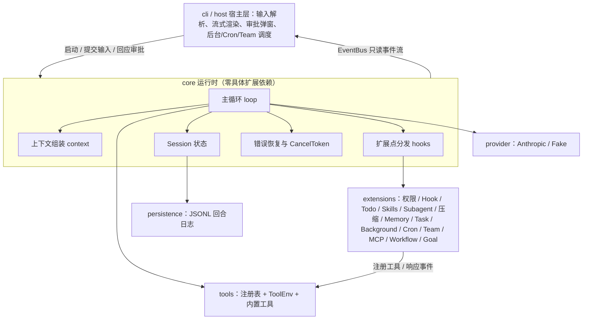
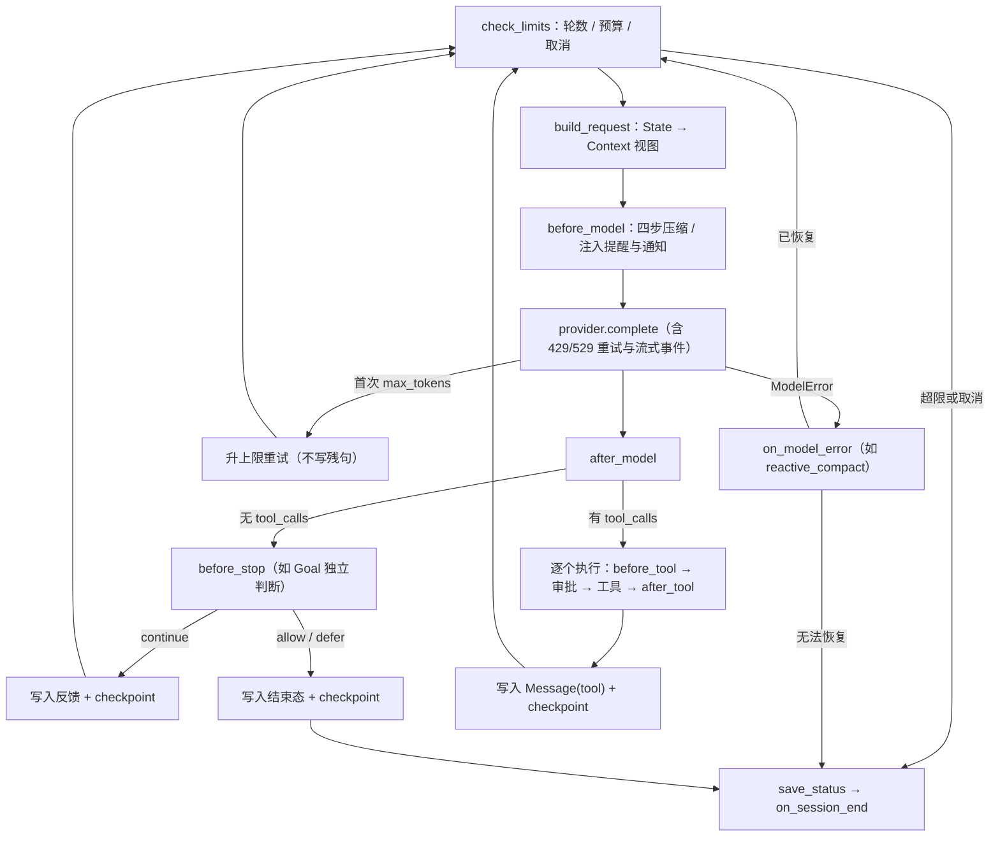

# Learn CC 工程化重建：设计方案（阶段 B · v2）

> [!NOTE]
> **v2 修订说明**：本方案已对齐参考仓库 `../learn-claude-code`（[SUMMARY.md](https://github.com/shareAI-lab/learn-claude-code/blob/main/SUMMARY.md)）真实的 **17 课主线（`s01`–`s17`）**，并结合对全机制集成原型 `s15_integrated_harness/code.py` 及 `s16_workflow_runtime` / `s17_goal_loop` 的源码分析，明确了重建边界与架构升级点。
>
> **已确认技术基线（阶段 B）**：
> - 语言与环境：**Python 3.11+（本机 3.13.2）+ `asyncio` + `uv` 管理独立 `.venv` + `src/` 布局**
> - 核心依赖：**极简零框架路线（D1）**——仅保留 `anthropic>=0.25.0`、`python-dotenv`、`pyyaml`，测试使用 `pytest` / `pytest-asyncio`
> - 流式输出：**M1 即原生接入**（通过 `Provider` 与 `EventBus` 推流式事件）
> - 模型与配置：先接 **Anthropic SDK**，配置沿用分级 `.env`（支持 `ANTHROPIC_BASE_URL`、`FALLBACK_MODEL_ID`、`GOAL_EVALUATOR_MODEL_ID`），`provider` 层预留中立接口
> - 推进路线：先完成 **M0–M4**（`s01`–`s09` + 持久化），随后继续 **M5/M6**（`s10`–`s17` 模块化扩展），再切入阶段 C；其余暂缓优化项统一记录于 [backlog.md](./backlog.md)

---

## 1. 目标、范围与对 `s15` 的架构升级

**阶段 B 的目标**：把 `learn-claude-code` 分散在 `s01`–`s17` 中的核心机制，装进 **`my-agent` 这个分层、无全局状态、全异步、可离线测试的工程化系统**中，显式消除机制间的隐式冲突。

### 1.1 既然已有 `s15_integrated_harness`，为什么还要在 `my-agent` 重建？

`s15_integrated_harness/code.py`（3,328 行）已经把 `s01`–`s14` 拼在了一起，但它是有意为教学保留的**单文件原型**，在工程上存在 6 处必须通过阶段 B 重建解决的结构性局限：

| 维度 | `s15_integrated_harness` 原型的做法 | `my-agent` 阶段 B 的工程化升级 |
|---|---|---|
| 状态与隔离 | 大量模块级全局变量（`HOOKS`、`background_tasks`、`cron_queue`、`active_teammates`、`rounds_since_todo`、`agent_lock`），连 `s09` 都要用 `importlib.util` 加载后覆写模块属性 | 全链路以 `Session` + `RunContext` 显式传参，**零全局可变状态**，支持多会话与子会话安全并发 |
| State 与 Context | `prepare_context()` 原地修改 `messages[:]`（`snip_compact` / `micro_compact` / `compact_history`），历史只能旁路写入 `.transcripts/` | `Session.messages` **只追加不改写**；压缩视图、摘要区间与落盘索引存入 `ext["compaction"]`，每次请求按需组装 `ModelRequest` |
| System 前缀稳定性 | `assemble_system_prompt()` 每轮重拼当前时间 `datetime.now()`、动态 `Memory` 召回与 `MCP` 列表，导致前缀缓存每轮失效 | `system` 与排序后的 `tools` 在会话内尽量保持稳定；动态记忆召回与 Todo 提醒通过 `ModelRequest.injections` 注入 |
| 主循环与扩展解耦 | `agent_loop()` 硬编码了 cron、background、`rounds_since_todo`、`compact` 工具特判、429/529/`max_tokens`/reactive compact；`s16` 甚至需要运行时 monkey-patch `host.assemble_tool_pool` | 统一 `Extension` 生命周期（含 `on_user_input` 与 `before_stop`），**M2 定型后不改 `core/loop.py`** |
| 异步与交互边界 | 同步 SDK + 多线程 + `threading.current_thread()` 判断是否能 `CONSOLE.ask()` 弹窗 | **asyncio + EventBus + `ApprovalBroker`**，核心运行时与终端输入/渲染彻底解耦，内置取消信号 |
| 协议与可测试性 | 直接混用 Anthropic SDK 对象与 `dict`（需用 `block_type()` 兼容），缺少纯内存全机制集成测试 | 内部中立类型（`TextBlock`/`ToolCall`/`ToolResult`/`Message`）+ `FakeProvider` 场景测试套件 + 回合级 `resume()` |

### 1.2 阶段 B 做与暂不做

| 做（阶段 B） | 暂不做（留给阶段 C） |
|---|---|
| 统一异步主循环 + 完整生命周期扩展点 | 多模型厂商适配（OpenAI / Gemini 等） |
| 核心主线 `s01`–`s09` + 会话持久化与 `resume()`（M0–M4） | 跨进程重启的审批暂停/恢复 |
| 进阶扩展 `s10`–`s14`、`s16`、`s17` 模块化迁入（M5–M6） | 工具副作用的幂等与重放保护 |
| `FakeProvider` + 单元/多机制联动场景测试 | 固定评测集、成功率/成本/Prompt Cache 命中率对比 |
| 设计决策日志 (`docs/design-log/`) | 真实远程 MCP HTTP/SSE 传输与 Web/HTTP 接口 |

**判断阶段 B 核心（M0–M4）成功的三条标准**
1. `s01`–`s09` 机制同时开启时，能在一个真实小仓库里完成“定位 → 修改 → 跑测试”的任务，并支持中断后 `resume`。
2. 从 **M2 结束起，新增机制（包括 M3–M6 的 `Todo`/`Skills`/`Subagent`/`Compaction`/`Memory`/`Background`/`Workflow`/`Goal`）不需要修改 `core/loop.py`**。
3. 核心逻辑（循环、权限、四步压缩、Subagent、Goal Stop Hook）都有不调用真实 API 的 `FakeProvider` 自动化测试。

---

## 2. 整体架构



**依赖规则（单向）**：
- `cli / host → core → (provider, tools)`
- `extensions → core 接口`（通过 `RunContext`、`Extension`、`ToolEnv`、`EventBus` 交互）
- **`core` 不 `import` 任何具体的 `extension`、`persistence` 实现或 `cli` 代码**。

### Hook 与 Event 的职责边界

| | Hook（扩展点） | Event（事件） |
|---|---|---|
| 作用 | **可影响控制流**：改写请求、拒绝/审批工具、替换工具结果、拦截退出 | **只读通知**：向外汇报状态变化（流式文本、工具进度、压缩、Goal 状态） |
| 使用者 | `extensions` | `cli` 渲染、Trace/日志、UI、测试断言 |
| 执行方式 | 按注册顺序依次 `await`，主循环等待结果 | 通过 `EventBus` 异步广播，不反向阻塞主循环 |
| 异常策略 | 拦截型（`before_tool`/`before_stop`）**fail-closed**；观察型（`after_*`/`on_session_*`）**fail-open** | 订阅者异常隔离，只记日志不影响主流程 |

---

## 3. 目录结构 (`my-agent/`)

```text
my-agent/
├── pyproject.toml
├── docs/
│   ├── learncc_rebuild_design.md   # 本架构设计文档
│   ├── backlog.md                  # 后续优化与暂缓方案清单
│   └── design-log/                 # 0001-xxx.md 重要决策记录
├── src/my_agent/
│   ├── core/
│   │   ├── types.py                # 内部中立类型：Message / Block / ToolCall / ToolResult
│   │   ├── session.py              # Session 状态（只追加 messages + ext 命名空间）
│   │   ├── context.py              # State → ModelRequest 组装与回合边界校验工具
│   │   ├── loop.py                 # 主循环（目标：M2 定型后不再修改）
│   │   ├── hooks.py                # Extension 基类、Decision/StopDecision 与分发器
│   │   ├── events.py               # 事件类型 + EventBus
│   │   ├── errors.py               # 错误分类（可重试 / 上下文超限 / 截断 / 不可重试）
│   │   ├── approval.py             # ApprovalBroker（前后台审批边界与冒泡接口）
│   │   └── cancel.py               # CancelToken（协作取消与子会话级联）
│   ├── provider/
│   │   ├── base.py                 # Provider 接口 + 429/529 重试与 fallback 包装
│   │   ├── anthropic.py            # 内部格式 ⇄ Anthropic 协议（支持流式与 base_url）
│   │   └── fake.py                 # 脚本化响应 + 请求录制，用于测试
│   ├── tools/
│   │   ├── base.py                 # Tool 定义、side_effect、ToolEnv（含动态 workdir）
│   │   ├── registry.py             # 注册、按名排序、Schema 校验、超时、截断与进程清理
│   │   └── builtin/                # bash(cmd.exe/sh) / read_file / write_file / edit_file / glob / grep
│   ├── extensions/                 # M2–M4 核心扩展
│   │   ├── permission.py           # s03 三道闸门权限
│   │   ├── user_hooks.py           # s04 用户配置 Hook 适配器
│   │   ├── todo.py                 # s05 会话内 Todo 与提醒注入
│   │   ├── subagent.py             # s06 一次性子会话（复用 loop.run）
│   │   ├── skills.py               # s07 技能目录与按需加载
│   │   ├── compaction.py           # s08 四步非破坏性压缩 + reactive_compact
│   │   └── memory.py               # s09 跨会话记忆索引、召回、提取与整理
│   ├── extensions_extra/           # M5–M6 进阶扩展（与核心扩展隔离，按需启用）
│   │   ├── tasks.py                # s10 持久化任务图 (.tasks/)
│   │   ├── background.py           # s11 后台 bash 进程管理与通知注入
│   │   ├── cron.py                 # s12 定时任务持久化与唤醒队列
│   │   ├── teams.py                # s13 持久队友、MessageBus、任务级 worktree 与协议
│   │   ├── mcp.py                  # s14 MCP 工具发现、命名归一化与宿主策略
│   │   ├── workflow.py             # s16 确定性脚本编排与 WorkflowJournal 续跑
│   │   └── goal.py                 # s17 /goal 命令与独立判断器 Stop Hook
│   ├── persistence/
│   │   └── store.py                # 会话 JSONL 读写与最后完整回合恢复
│   ├── cli/                        # app.py / render.py / approval.py / host_scheduler.py
│   └── config.py
└── tests/
    ├── unit/                       # 单模块规则、边界、编码、截断、Cron/Schema 校验
    └── scenario/                   # FakeProvider 跑完整多机制协同对话
```

---

## 4. 核心数据模型

### 4.1 内部中立的消息格式

`core` 和 `extensions` 不直接使用 Anthropic SDK 的 Block 对象（解决 `s15` 混用 `dict` 与 SDK 对象导致的脆弱判断）。协议转换全权下沉到 `provider/anthropic.py`。

```python
# core/types.py
@dataclass(frozen=True)
class TextBlock:
    text: str

@dataclass(frozen=True)
class ToolCall:
    id: str
    name: str
    args: dict[str, Any]

@dataclass(frozen=True)
class ToolResult:
    call_id: str
    content: str
    is_error: bool = False

Block = TextBlock | ToolCall | ToolResult

@dataclass
class Message:
    role: Literal["user", "assistant", "tool"]  # 内部统一用 "tool" 承载 ToolResult
    blocks: list[Block]

@dataclass
class Usage:
    input_tokens: int = 0
    output_tokens: int = 0
    cache_read_tokens: int = 0      # 阶段 C 统计 Prompt Cache 时直接可用，无需改数据结构
    cache_write_tokens: int = 0

    def __iadd__(self, other: "Usage") -> "Usage": ...

@dataclass(frozen=True)
class ModelResponse:
    message: Message
    usage: Usage
    stop_reason: Literal["end_turn", "tool_use", "max_tokens", "stop_sequence"]

    @property
    def tool_calls(self) -> list[ToolCall]: ...

    @property
    def text(self) -> str: ...
```

> [!TIP]
> Anthropic 协议把 `tool_result` 放在 `user` 消息里，OpenAI 使用独立 `tool` 角色。内部统一使用 `role="tool"`，由 `provider/anthropic.py` 在发送前合并映射成符合 Anthropic 规范的 `user(tool_result)` 消息。

### 4.2 Session（State）与 ModelRequest（Context）分离

```python
# core/session.py
SessionStatus = Literal[
    "running", "done", "deferred", "cancelled", "failed", "max_turns"
]

@dataclass
class Session:
    id: str
    parent_id: str | None = None                            # Subagent / Teammate 子会话指向父会话
    messages: list[Message] = field(default_factory=list)   # 完整历史，只追加不删改
    ext: dict[str, Any] = field(default_factory=dict)       # 扩展私有状态（必须可 JSON 序列化）
    turn: int = 0
    usage: Usage = field(default_factory=Usage)
    status: SessionStatus = "running"
```

```python
# core/context.py
@dataclass
class ModelRequest:
    system: str                                             # 会话内保持稳定（不写入每秒变动的时间戳）
    tools: list[ToolSpec]                                   # 按 name 排序，保持稳定
    messages: list[Message]                                 # 历史视图副本（供 CompactionExtension 非破坏性裁剪）
    injections: list[Message] = field(default_factory=list) # 本轮临时注入（Todo 提醒、动态记忆、通知等），不落盘
    max_tokens: int = 8000                                  # 可由 max_tokens 恢复逻辑按单次请求升级
    model: str | None = None                                # 留给 fallback 或子会话覆盖

# 回合边界保护与校验（供 CompactionExtension 与 resume() 复用）
def is_turn_boundary(messages: list[Message], index: int) -> bool:
    """True 表示可在 index 处安全切分（不会拆散 assistant(ToolCall) 与紧随其后的 tool(ToolResult)）。"""

def validate_tool_pairs(messages: list[Message]) -> list[str]:
    """返回所有孤立 ToolCall / ToolResult 的诊断信息，供单测和恢复校验使用。"""
```

**三项核心隔离原则**：
1. **历史只增不改**：`Session.messages` 永不被原地修改或截断。压缩扩展把摘要、覆盖边界 `k` 和已转存的工具结果索引记录在 `Session.ext["compaction"]` 中，由 `before_model` 对 `req.messages` 的视图副本做裁剪或替换。
2. **临时消息不污染 State**：`Todo` 提醒、动态召回记忆、Goal 调试提示等放进 `req.injections`，请求发出时拼在末尾，不写回 `Session.messages`。
3. **回合边界不变量的强制保护**：`is_turn_boundary()` 与 `validate_tool_pairs()` 保证任何裁剪/切片都不会把 `assistant(ToolCall)` 和紧随其后的 `tool(ToolResult)` 拆开。

### 4.3 运行时上下文、审批、取消与事件契约

```python
# core/approval.py
ApprovalChoice = Literal["allow_once", "allow_session", "deny"]

@dataclass(frozen=True)
class ApprovalResult:
    choice: ApprovalChoice
    reason: str = ""

class ApprovalBroker(Protocol):
    async def request_approval(
        self, *, session_id: str, tool_call: ToolCall,
        reason: str, source: str, is_interactive: bool,
    ) -> ApprovalResult: ...

# core/cancel.py
class CancelToken:
    def cancel(self, reason: str = "cancelled") -> None: ...
    @property
    def is_cancelled(self) -> bool: ...
    def raise_if_cancelled(self) -> None: ...
    def child(self) -> "CancelToken": ...                    # 父取消级联子取消；子取消不影响父
    def on_cancel(self, cb: Callable[[], None]) -> Callable[[], None]: ...  # 用于终止子进程或流连接

# core/events.py
class EventBus:
    def subscribe(self, handler: Callable[[Event], Awaitable[None] | None]) -> Callable[[], None]: ...
    async def emit(self, event: Event) -> None: ...           # 顺序 await 保序（流式 TextDelta 不乱序），内部隔离异常

# core/context.py (或 core/session.py)
@dataclass
class RunLimits:
    max_turns: int = 50
    max_tokens_budget: int | None = None

@dataclass
class RunContext:
    session: Session
    provider: Provider
    tools: ToolRegistry
    hooks: HookDispatcher
    events: EventBus
    approval: ApprovalBroker
    store: SessionStore
    cancel: CancelToken
    workdir: Path
    system_prompt: str                                        # 启动期组装后冻结
    is_interactive: bool = True
    limits: RunLimits = field(default_factory=RunLimits)

    def fork_child(
        self, child_session: Session, *,
        tools: ToolRegistry, hooks: HookDispatcher, limits: RunLimits | None = None,
    ) -> "RunContext": ...                                    # 供 Subagent/Teammate 派生隔离上下文与级联 CancelToken
```

---

## 5. 主循环、扩展点与错误恢复

### 5.1 Extension 接口（补齐 `s04` / `s17` 所需生命周期）

对比原方案 v1，这里补齐了 **`on_user_input`**（对应 `s04` `UserPromptSubmit` 与 `/goal` 等命令拦截）和 **`before_stop`**（对应 `s04`/`s17` 的 `Stop` 钩子，决定模型停止调用工具时是放行、继续还是延迟等待）。

```python
# core/hooks.py
@dataclass(frozen=True)
class Allow: pass

@dataclass(frozen=True)
class Deny:
    reason: str

@dataclass(frozen=True)
class Ask:
    prompt: str

Decision = Allow | Deny | Ask

@dataclass(frozen=True)
class StopDecision:
    action: Literal["allow", "continue", "defer"]
    message: str | None = None      # continue 时注入给模型的消息（如 Goal 未达成原因）

@dataclass(frozen=True)
class InputPass:
    text: str                       # 经预处理或原样透传给模型的用户输入

@dataclass(frozen=True)
class InputHandled:
    reply: str                      # 纯本地命令（如 /goal 状态、/goal clear）直接回复，跳过模型调用

InputAction = InputPass | InputHandled

class Extension:
    name: str = "base"

    def tools(self) -> list[Tool]: return []
    def system_sections(self) -> list[str]: return []   # 仅会话启动组装稳定 system

    async def on_session_start(self, ctx: RunContext) -> None: ...
    async def on_user_input(self, ctx: RunContext, text: str) -> InputAction | None: ...
    async def before_model(self, ctx: RunContext, req: ModelRequest) -> None: ...      # 可变换 req.messages / injections
    async def after_model(self, ctx: RunContext, resp: ModelResponse) -> None: ...
    async def before_tool(self, ctx: RunContext, call: ToolCall) -> Decision | None: ...
    async def after_tool(self, ctx: RunContext, call: ToolCall, result: ToolResult) -> ToolResult | None: ...
    async def before_stop(self, ctx: RunContext, resp: ModelResponse) -> StopDecision | None: ...
    async def on_model_error(self, ctx: RunContext, error: ModelError, req: ModelRequest) -> bool: ...  # True=已补救可重试
    async def on_session_end(self, ctx: RunContext) -> None: ...
```

**分发与容错规则**：
- `before_tool`（**fail-closed**）：任一扩展返回 `Deny` 或抛出异常，立即拒绝执行；出现 `Ask` 走 `ApprovalBroker`（若为非交互后台/定时轮次，默认拒绝 `Ask`）；全员 `None`/`Allow` 才执行。
- `after_tool`（**fail-open**）：返回非 `None` 时链式替换 `ToolResult`；若扩展异常则记录警告并保留原结果继续。
- `before_stop`（**fail-closed 对连续自动拦截设保护**）：任一扩展返回 `continue`（例如 `GoalExtension` 判断未达成）即把反馈作为新消息追加后继续下一轮；返回 `defer`（如还有后台任务运行中）则暂停退出并让出控制权给宿主等待通知；全员 `None`/`allow` 时结束本轮并返回 `"done"`。
- `on_model_error`：例如 `CompactionExtension` 可响应 `PromptTooLongError` 执行一次 `reactive_compact` 并返回 `True` 触发重试，从而无需把压缩逻辑硬编码进 `loop.py`。

> [!TIP]
> **为什么这样设计后 M2 以后真的不用改 `loop.py`？**
> - `s08` 的 `compact` 工具不需要循环特判：工具执行时只在 `ext["compaction"]["pending_manual"] = True` 打标记，让本批所有 `ToolResult` 正常落盘；下一轮 `before_model` 检测到标记即执行摘要。
> - `s11` 的 `run_in_background=True` 不需要循环特判：由 `BackgroundExtension` 注册的 `bash` 工具内部异步起进程并返回 `bg_id` 占位字符串，完成事件在下轮 `before_model` 注入。
> - `s17` 的 `/goal` 不需要循环特判：通过 `on_user_input` 解析并存储 Goal，通过 `before_stop` 拦截退出并注入判断反馈。

### 5.2 主循环骨架

```python
# core/loop.py
async def submit(ctx: RunContext, user_text: str) -> SubmitOutcome:
    """交互入口：先过 on_user_input；Handled 直接返回，Pass 则追加用户消息并进入 run()."""
    action = await ctx.hooks.on_user_input(ctx, user_text)
    if isinstance(action, InputHandled):
        return SubmitOutcome(session=ctx.session, direct_reply=action.reply)
    final_text = action.text if isinstance(action, InputPass) else user_text
    ctx.session.messages.append(Message("user", [TextBlock(final_text)]))
    return SubmitOutcome(session=await run(ctx))

async def run(ctx: RunContext) -> Session:
    s = ctx.session
    s.status = "running"
    await ctx.hooks.on_session_start(ctx)
    max_tokens_override: int | None = None
    continuations = 0
    try:
        while True:
            if (stop := check_limits(ctx)):                 # max_turns / 预算 / 取消
                s.status = stop
                await ctx.store.save_status(s)
                break

            req = build_request(ctx, max_tokens_override)   # State → ModelRequest 视图
            await ctx.hooks.before_model(ctx, req)

            try:
                resp = await ctx.provider.complete(req, ctx.cancel, ctx.events)
            except ModelError as err:
                if await ctx.hooks.on_model_error(ctx, err, req):
                    continue
                raise

            s.usage += resp.usage                           # 截断尝试同样计入 token 用量
            if resp.stop_reason == "max_tokens" and max_tokens_override is None:
                max_tokens_override = req.max_tokens * 2    # 首次截断先升上限重试，不写残句
                continue

            max_tokens_override = None
            s.messages.append(resp.message)
            await ctx.hooks.after_model(ctx, resp)

            if resp.stop_reason == "max_tokens" and not resp.tool_calls and continuations < 2:
                continuations += 1
                s.messages.append(Message("user", [TextBlock(CONTINUATION_PROMPT)]))
                s.turn += 1
                await ctx.store.checkpoint(s)
                continue

            continuations = 0
            if not resp.tool_calls:
                stop_decision = await ctx.hooks.before_stop(ctx, resp)
                if stop_decision.action == "continue":
                    s.messages.append(Message("user", [TextBlock(stop_decision.message or "")]))
                    s.turn += 1
                    await ctx.store.checkpoint(s)
                    continue
                s.status = "deferred" if stop_decision.action == "defer" else "done"
                s.turn += 1
                await ctx.store.checkpoint(s)               # 正常/延迟结束前同样落盘本回合
                break

            results = [await run_one_tool(ctx, call) for call in resp.tool_calls]
            s.messages.append(Message("tool", results))
            s.turn += 1
            await ctx.store.checkpoint(s)
    except Cancelled:
        s.status = "cancelled"
        await ctx.store.save_status(s)
    except Exception:
        s.status = "failed"
        await ctx.store.save_status(s)
        raise
    finally:
        await ctx.hooks.on_session_end(ctx)
    return s
```



### 5.3 分层错误与恢复策略（吸收 `s15` 实战经验）

| 错误来源 | 典型场景 | 所在层 | 处理方式 |
|---|---|---|---|
| Provider 限流/过载 | `429`、`529`、临时断网 | `provider/` | 指数退避 + 随机抖动重试 `N` 次；连续 `529` 达阈值切换 `fallback_model` |
| Provider 上下文超限 | `prompt_too_long` | `errors.py` + `CompactionExtension` | 抛出可识别的 `PromptTooLongError`，由 `on_model_error` 触发最多 1 次 `reactive_compact` 重试 |
| 输出被截断 | `stop_reason == "max_tokens"` | `provider/` 或 `loop` 恢复策略 | 首次自动提升 `max_tokens` 上限重试；再次触发则保留半截输出并追加 continuation 提示继续（设上限） |
| Provider 不可重试错误 | `400` 参数错误、`401/403` 认证失败 | `provider/` | 直接抛错，会话标为 `failed` |
| 工具执行 / 参数错误 | 文件不存在、非 0 退出、超时、Schema 不匹配 | `tools/registry.py` | **不中断循环**，转为 `ToolResult(is_error=True)` 回传模型并给出可恢复提示 |
| 拦截型 Hook 出错 | `before_tool` / `before_stop` 抛异常 | `core/hooks.py` | **fail-closed**：宁可拒绝/停止自动继续，并显式记录与汇报 |
| 观察型 Hook 出错 | 日志 / `after_model` / `after_tool` / `Memory` 提取抛异常 | `core/hooks.py` | **fail-open**：发错误事件并继续主流程 |
| 用户取消 (`Ctrl+C`) | `CancelToken.cancel()` | `core/cancel.py` + `tools/` | 中断流式请求并终止活跃子进程（Windows 使用 `terminate/kill`，POSIX 使用 `os.killpg`），级联取消子会话 |

---

## 6. 工具系统 (`tools/`)

```python
# tools/base.py
@dataclass
class ToolEnv:
    workdir: Path                         # 动态工作目录（支持 s13 worktree 隔离）
    session_id: str
    ext: dict[str, Any]                   # 当前会话扩展状态（供内部工具访问）
    cancel: CancelToken
    is_interactive: bool                  # 是否允许前向弹窗（区分前台轮次 vs 后台/Cron）

@dataclass
class Tool:
    name: str
    description: str
    schema: dict[str, Any]
    handler: Callable[[dict[str, Any], ToolEnv], Awaitable[str]]
    side_effect: Literal["read", "write", "exec"] = "read"
    timeout_s: float = 120.0
    max_output_chars: int = 20_000
```

- **路径安全边界**：文件工具统一通过 `safe_path(path, env.workdir)` 解析；越界操作在工具层与权限扩展层双保险拦截。
- **跨平台命令执行与编码**：Windows 下 `bash` 工具通过 `cmd.exe` 执行（并在 `system_sections` 提示模型使用 `cmd.exe` 语法或优先文件工具），使用 `errors="replace"` / UTF-8 容错解码，避免如 `test_subprocess_output_encoding.py` 中的本地代码页崩溃。
- **注册表职责**：按名称排序导出 `ToolSpec`（保证每次请求工具定义顺序一致）、执行前做轻量 JSON Schema 校验、统一超时/进程清理与首尾截断。

---

## 7. `s01`–`s17` 全章节迁入与机制冲突决策

| 章节 | 迁入模块 | 依赖的扩展点 | 私有状态 `ext[...]` | 关键冲突与工程决策 |
|---|---|---|---|---|
| **s01 Loop** | `core/loop.py` | — | — | 主循环保持最小且 M2 后冻结；能力全部外挂 |
| **s02 Tools** | `tools/` | — | — | 统一 `ToolEnv`、超时、截断、`safe_path` 与 Windows 编码容错 |
| **s03 Permission** | `PermissionExtension` | `before_tool` | `permission` | 三道闸门（硬拒绝词表 / 规则与 `side_effect` / `ApprovalBroker`）；**异步或非交互轮次（Cron/Teammate）遇 `Ask` 直接拒绝**，不抢占 CLI stdin |
| **s04 Hooks** | `UserHooksExtension` | 多个生命周期 | — | 区分框架级 `Extension` 与配置文件里的用户脚本 Hook；脚本超时/崩溃按拦截型 vs 观察型隔离 |
| **s05 Todo** | `TodoExtension` | 工具 + `before_model` | `todo` | Todo 存在 `ext["todo"]` 而非消息中，压缩不丢；连续 3 轮未调用 `todo_write` 时通过 `req.injections` 提醒 |
| **s06 Subagent** | `SubagentExtension` | 工具 (`task`) | `subagents` | 创建子 `Session` 并**复用同一个 `loop.run()`**（详见 7.1） |
| **s07 Skills** | `SkillsExtension` | `system_sections` + 工具 | `skills` | 启动扫描 `skills/*/SKILL.md`，仅目录进稳定 `system`；正文通过 `load_skill` 走 `ToolResult` |
| **s08 Compaction** | `CompactionExtension` | `before_model` + `on_model_error` + 工具 | `compaction` | **非破坏性四步递进管线** + `compact` 延迟标记 + `reactive_compact`（详见 7.2） |
| **s09 Memory** | `MemoryExtension` | `system_sections` + `before_model` + `on_session_end` | `memory` | `.memory/MEMORY.md` 索引与 4 类文件；启动加载稳定记忆，动态相关性召回走 `injections` 保护缓存（详见 7.3） |
| **s10 Task System** | `TaskExtension` | 工具 (`*_task`) | — | `.tasks/{id}.json` 持久化 DAG；坚持两阶段建图（先 `create_task` 拿运行时 ID，再 `update_task` 加 `blockedBy`）与依赖检查 |
| **s11 Background** | `BackgroundExtension` | 工具 (`bash`) + `before_model` | `background` | `run_in_background=True` 立即回 `bg_id` 占位；进程组生命周期绑定 `CancelToken`；完成后在 `before_model` 注入 `<task_notification>` |
| **s12 Cron** | `CronExtension` | 工具 (`*_cron`) + Host 队列 | — | 5 段式 cron 校验 + `.scheduled_tasks.json`；`pending_delivery` 实现至少一次交付；**与 CLI 共用 Host 事件调度，到点非交互执行** |
| **s13 Teams & Worktree** | `TeamExtension` | 工具 + `ToolEnv.workdir` + Host | `team` | 持久 `TeammateRuntime` 复用 `loop.run()`；`.mailboxes/` + 原子任务认领 + 任务级 Git worktree；**worktree 只切默认 `cwd` 不是沙箱，移除权留给宿主** |
| **s14 MCP** | `MCPExtension` | 工具动态装配 + `before_tool` | `mcp` | `mcp__{server}__{tool}` 归一化与冲突拒绝；**不信任 server hints，使用宿主策略白名单**；启动期静态装配优先以保缓存 |
| **s15 Integrated** | 对照基准 | 全机制 | — | 作为功能对齐与反面架构参考，不作为独立代码层迁入（见 1.1） |
| **s16 Workflow** | `WorkflowExtension` | 工具 (`Workflow`) | `workflows` | 宿主注册可信编排脚本（`agent/parallel/pipeline/phase`）；Schema 校验单次重试；`WorkflowJournal` 用调用语义哈希键断点续跑 |
| **s17 Goal Loop** | `GoalExtension` | `on_user_input` + `before_stop` | `goal` | `/goal` 命令配置条件；模型停止时由独立无工具 `GoalEvaluator` 审核历史；有未完异步任务返回 `defer`；受 `max_turns` 与连续阻止上限保护 |

### 7.1 Subagent 设计 (`s06`)
- **同一执行内核**：`task` 工具创建子 `Session(parent_id=ctx.session.id)`，调用**同一个 `core.loop.run()`**，继承相同的重试、取消、事件与工具超时体系（不再复制 `s15` 中的 `for _ in range(30)` 简化循环）。
- **权限收窄与审批冒泡**：子会话工具集只能是父会话的子集（默认剔除 `task` 防止无限递归，或限制深度 ≤ 2）；权限规则取父子交集；子会话触发 `Ask` 时通过 `ApprovalBroker` 冒泡到 CLI，标明 `[subagent:<role>]`。
- **结果与取消**：只把最终总结文本作为 `ToolResult` 返回父会话；子会话完整历史落盘为独立日志文件（通过 `parent_id` 关联）。父会话 `CancelToken` 触发时自动级联取消所有活跃子会话。

### 7.2 四步上下文压缩与非破坏性视图 (`s08`)
沿用 `s08` 验证过的“**低成本无损/可恢复操作优先，大模型有损摘要兜底**”四步管线，但在 `my-agent` 中改为**对 `ModelRequest.messages` 视图非破坏性执行**，保护 `Session.messages` 原文：
1. **`tool_result_budget`**：检查最新一批 `ToolResult`，若单轮超总预算（如 200KB），按从大到小将超大结果落盘到 `.task_outputs/tool-results/<call_id>.txt`，在 `ext["compaction"]["persisted"]` 中记录替换路径与预览。
2. **`snip_compact`**：当视图消息条数超阈值时，写全量归档到 `.transcripts/` 并裁剪中段历史，只留头部锚点、归档路径标记和最近尾部。
3. **`micro_compact` & `fit_tool_results`**：仅在总字符/估算 token 超限时触发。对已消费的较早 `ToolResult`（保留最近 3 条）替换为可恢复路径引用；若未读取的新批次本身就超限，则保留 1000 字预览 + 文件路径。
4. **`compact_history`（+ `compact` 工具 & `reactive_compact`）**：仍超限或收到 `pending_manual` 标记时，生成只包含事实状态的摘要并写入 `ext["compaction"]["summary"]` 与覆盖边界 `covered_until`；若模型调用仍遭 `prompt_too_long` 拒绝，则由 `on_model_error` 触发一次 `reactive_compact`。

**铁律**：第 2、4 步的切分点必须通过 `is_turn_boundary()` 对齐到完整回合边界，严禁拆散成对的 `ToolCall` 和 `ToolResult`。

### 7.3 Memory 与 Prompt Cache 协同 (`s09`)
- `s09` 原做法每轮都查 `.memory/` 并重写 `system_sections`，这与 Prompt Cache 前缀稳定冲突。
- **阶段 B 裁决**：
  - 会话启动时，将固定的记忆使用说明与启动期基础记忆索引放入 `system`（会话内不变）；
  - 每轮根据当前请求动态筛选出的相关记忆正文，通过 `ModelRequest.injections` 作为临时背景段附在末尾（并在 prompt 中明确声明“仅作背景参考，与当前用户指令冲突时以当前请求为准”）；
  - `on_session_end`（或对话空闲收敛后）异步执行 `extract_memories`（校验 `scope == "persistent"` 并拒绝临时约束）及基于快照回滚的 `consolidate_memories`，**新写入的记忆下一次会话才进入启动 `system`**。

### 7.4 多事件源宿主调度 (`s11` / `s12` / `s13` / `s17`)
在 `my-agent` 中不复用 `s15` 的 `while True: time.sleep(1) + threading.Lock` 轮询，而是由 `cli/host_scheduler.py` 维护一个基于 `asyncio.Queue` 的**会话事件复用器**：
- 前台用户输入、后台 Bash 完成（`s11`）、Cron 到期（`s12`）和 Teammate 收件箱消息（`s13`）统一投递事件；
- 当正在执行主会话回合时，后台与 Team 事件在下一轮 `before_model` 顺滑注入，或等待当前回合结束后唤醒下一轮；
- 只有前台用户驱动的轮次 `ToolEnv.is_interactive = True`，任何异步唤醒轮次中触发 `Ask` 权限请求均按 `Deny` 处理（与 `s15` 一致的安全边界），防止后台线程与终端输入竞争。

---

## 8. 持久化 JSONL 规范与恢复机制（阶段 B 边界）

### 8.1 日志格式（`.sessions/<session_id>.jsonl`）
采用**消息按回合增量追加 + 扩展状态整份快照**的 UTF-8 JSONL 格式（每写完一行立即 `flush`）。每个子会话（`Subagent` / `Teammate`）写各自独立的 `<session_id>.jsonl` 并通过 `parent_id` 关联，避免多协程抢写同一文件。

1. **会话头（创建时写 1 行）**：
   ```json
   {"v": 1, "type": "session_meta", "session_id": "ses_01J...", "parent_id": null, "workdir": "/path/to/workspace", "created_at": "2026-11-17T13:05:00+08:00"}
   ```
2. **回合检查点（每完成一个闭合回合追加 1 行）**：
   ```json
   {
     "v": 1,
     "type": "turn_checkpoint",
     "turn": 2,
     "ts": "2026-11-17T13:05:18+08:00",
     "status": "running",
     "new_messages": [
       {"role": "user", "blocks": [{"type": "text", "text": "修复 test_a.py"}]},
       {"role": "assistant", "blocks": [{"type": "tool_call", "id": "tc_1", "name": "read_file", "args": {"path": "test_a.py"}}]},
       {"role": "tool", "blocks": [{"type": "tool_result", "call_id": "tc_1", "content": "...", "is_error": false}]}
     ],
     "usage": {"input_tokens": 1200, "output_tokens": 85, "cache_read_tokens": 0, "cache_write_tokens": 0},
     "ext": {
       "todo": {"items": [...], "rounds_since_update": 0},
       "compaction": {"covered_until": 0, "summary": null, "persisted": {}},
       "permission": {"session_allowed": ["edit_file"]}
     }
   }
   ```
3. **状态闭合行（异常中断、取消或结束时写入）**：
   ```json
   {"v": 1, "type": "session_status", "turn": 2, "status": "cancelled", "ts": "2026-11-17T13:05:25+08:00"}
   ```

### 8.2 `resume(session_id)` 恢复与容错规则
- **半行容错**：按行解析；若进程写盘中途崩溃导致最后一行缺少完整 JSON 或换行，安全丢弃该残行并保留之前所有闭合回合。
- **消息配对校验**：恢复后自动调用 `validate_tool_pairs(session.messages)`；若发现尾部存在未配对的 `ToolCall`（或非法残片），自动回退到上一个合法回合边界，防止恢复后调用模型直接报 `400`。
- **增量 vs 快照权衡**：`new_messages` 每轮只记增量避免 $O(N^2)$ 重写；`ext` 体积小，每轮存整份快照直接覆盖恢复，不需要为每个扩展单独编写事件重放逻辑。
- **阶段 B 已知边界（留待阶段 C 解决）**：若 `write_file` / `bash` 工具已产生外部副作用但尚未写入回合 checkpoint 时崩溃，恢复后模型可能重放该工具调用；此边界将记入设计日志，并在阶段 C 引入操作幂等或重放检查。
- **独立系统状态**：开启 M5–M6 扩展时，`.tasks/`、`.memory/`、`.scheduled_tasks.json`、`.mailboxes/` 与 `workflow/.runtime/<runId>.journal.jsonl` 各自原子写入（临时文件 + `os.replace()`）。

---

## 9. 测试策略与各里程碑验收用例

```python
fake = FakeProvider([
    resp(tool_calls=[call("read_file", path="a.py")]),
    resp(text="a.py 定义了函数 foo"),
])
s = await run(make_ctx(fake, tools=[read_file]))
assert s.status == "done"
assert fake.requests[1].messages[-1].blocks[0].content.startswith("def foo")
```

除每个里程碑结束跑 1–2 个真实 API 冒烟验证外，核心逻辑与多机制交互全部由 `FakeProvider` + 临时目录自动化覆盖：

| 里程碑 | 单元测试焦点 (`tests/unit/`) | 多机制联动场景焦点 (`tests/scenario/`) |
|---|---|---|
| **M0 骨架** (`s01`) | `is_turn_boundary` / `validate_tool_pairs` 边界；`CancelToken` 父子级联；`EventBus` 流式严格保序与订阅者异常隔离 | `FakeProvider` 3 轮工具循环闭合；执行中触发取消；`on_user_input` 返回 `InputHandled` 跳过模型调用；`before_stop` 桩测试 `allow`/`continue`/`defer` 与收尾 `checkpoint` |
| **M1 能用** (`s02` + 流式) | 内部 `role="tool"` 转 Anthropic `user(tool_result)`、`ToolSpec` 排序、`429/529` 退避及切换 `fallback_model`；`safe_path` 防穿越；Windows `cmd.exe` 非 UTF-8 输出不崩、超时杀进程、首尾截断 | 流式 `TextDelta` 拼装成完整文本并驱动下一轮 ToolCall；**真实 API 冒烟**：临时仓库读文件 → 改代码 → 跑测试 |
| **M2 扩展点定型** (`s03`–`s04`) | `PermissionExtension` 三道闸门（DenyList、破坏性命令词边界、`side_effect` 默认策略、`allow_session` 复用）；`UserHooksExtension` 脚本超时捕获 | `before_tool` 抛异常时 **fail-closed 拒绝**；`after_tool` 抛异常时 **fail-open 保留结果继续**；`is_interactive=False` 时遇 `Ask` 自动转 `Deny`（**自本里程碑起冻结 `core/loop.py`**） |
| **M3 复杂任务** (`s05`–`s07`) | `TodoManager`（上限 20 项、仅 1 个 `in_progress`）；`SkillsExtension` 只将目录进 `system` | 连续 3 轮未更新 Todo 后第 4 次请求 `injections` 收到提醒但 `Session.messages` 无污染；`load_skill` 后 `req.system` 前缀不变；`Subagent` 剔除 `task`、权限取交集、`Ask` 冒泡带 `[subagent:...]` 标记、父取消级联子取消 |
| **M4 记忆与恢复** (`s08`–`s09` + 持久化) | 四步压缩逐级触发（大输出转存 → `snip` → `micro` 保留最近 3 条 → `compact_history`）；切分点落在调用对之间自动退让；`Memory` 过滤 `current_task` 与整理失败回滚；JSONL 半行损坏截断容错 | **压缩后 `ext["todo"]` 不丢**且继续提醒；同批并行调用 `write_file` + `compact` 时等整批落盘后下一轮才摘要；`PromptTooLongError` 触发 1 次 `reactive_compact` 重试成功；本轮写 Memory 不改当前 `system`；崩溃模拟后 `resume()` 续跑完成 |
| **M5 进阶扩展** (`s10`–`s12`, `s14`) | `Task` 依赖环拒绝与 `blockedBy` 解锁；`Cron` 5 段校验与原子落盘；`MCP` 名称归一化碰撞检测（`a.b/c` vs `a_b/c`）与忽略 server hints | `bash(run_in_background=True)` 立即回 `bg_id`，下轮 `before_model` 收到 `<task_notification>`；`Cron` 到点非交互轮次自动拒绝危险 `Ask` |
| **M6 协作与闭环** (`s13`, `s16`, `s17`) | 原子认领防双占、`assignment` 变更使旧审批失效；Worktree 路径逃逸拦截；`Workflow` 语义哈希无视并发顺序与 Schema 重试 1 次；`GoalController` 状态机 | 中断后 `resume_from_run_id` 续跑 `Workflow`，命中缓存零 API 调用；`/goal` 触发 `before_stop`：未达标注入继续、后台未完返回 `defer`、连续阻止达 `block_cap` 时熔断退回用户且保留活跃 Goal |

---

## 10. 里程碑规划（M0–M6）

| 里程碑 | 范围与对应章节 | 交付内容 | 完成标准 |
|---|---|---|---|
| **M0 骨架** | `s01` + 基础设施 | `types`、`Session`、`ModelRequest`、`core/loop.py`（含全部扩展点签名）、`hooks`、`events`、`cancel`、`FakeProvider` | 用 `FakeProvider` 跑通多轮工具调用与取消的场景测试 |
| **M1 能用** | `s02` + 流式与基础恢复 | `tools` 注册表 + 6 个内置工具（`bash`/`read_file`/`write_file`/`edit_file`/`glob`/`grep`）、`AnthropicProvider`（流式 + 429/529 重试）、最简 CLI | 真实 API 下能在 Windows 终端读文件、改文件、跑命令 |
| **M2 扩展点定型** | `s03`–`s04` | `HookDispatcher`（fail-closed/open 隔离）、`ApprovalBroker`、`PermissionExtension`、`UserHooksExtension` | **核心冻结**：`core/loop.py` 定型；权限测试覆盖拒绝、允许、询问与异步默认拒绝 |
| **M3 复杂任务** | `s05`–`s07` | `TodoExtension`、`SkillsExtension`、`SubagentExtension`（复用 `loop.run()`） | **零修改 `core/loop.py`**；子会话权限收窄、审批冒泡与级联取消均通过场景测试 |
| **M4 记忆与恢复** | `s08`–`s09` + 持久化 | `CompactionExtension`（四步管线 + `reactive_compact`）、`MemoryExtension`、`persistence/store.py` | **零修改 `core/loop.py`**；压缩后 Todo 不丢、工具对不拆分；中断后可 `resume`；完成阶段 B 核心验收 |
| **M5 进阶（异步与外部能力）** | `s10`–`s12`, `s14` | `TaskExtension`、`BackgroundExtension`、`CronExtension`、`MCPExtension`（可选按需开启） | **零修改 `core/loop.py`**；后台通知注入、Cron 唤醒、MCP 前缀防冲突与宿主白名单通过测试 |
| **M6 进阶（协作与闭环）** | `s13`, `s16`, `s17` | `TeamExtension`（Teammate + Worktree）、`WorkflowExtension`、`GoalExtension` | **零修改 `core/loop.py`**；Workflow journal 续跑、Goal `before_stop` 拦截/defer/熔断通过测试 |

> [!IMPORTANT]
> **里程碑检查铁律**：从 M2 结束开始，每次提交里程碑前检查 `git diff` 是否改动了 `core/loop.py`。如果有，必须暂停并在 `docs/design-log/` 写清原因，反审是不是扩展点接口缺少能力。

---

## 11. 设计日志模板 (`docs/design-log/NNNN-标题.md`)

```markdown
# 0001 Todo 状态放在 State 而不是消息里

## 背景
Learn CC s05 将 Todo 保存在内存全局列表中；合并到完整系统后与上下文压缩和会话恢复产生交互。

## 冲突
s08 上下文压缩会归档或总结早期消息，若把 Todo 仅留在消息历史中会丢失；若放进 system prompt 又会频繁破坏缓存。

## 考虑过的方案
1. 压缩时特判保留 Todo 相关消息：切分逻辑复杂，与工具调用配对校验耦合。
2. Todo 存入 `Session.ext["todo"]`，连续 3 轮未更新时通过 `ModelRequest.injections` 临时提醒：✅ 采用。

## 决策与代价
代价：触发提醒的轮次多出几十个 token，但 `Session` 可完整序列化恢复且不污染历史。

## 验证
tests/scenario/test_compaction_keeps_todo.py
```

---

## 12. 已确认的技术决策（M0 前拍板结果）

1. **技术栈与依赖**：确认采用 `Python 3.13 + asyncio` + `uv` 管理独立 `.venv` + `src/` 包布局；核心运行时维持 **D1 极简依赖**（`anthropic`、`python-dotenv`、`pyyaml`），测试采用 `pytest`（+ `pytest-asyncio`）。轻量依赖增强（`pydantic`/`jsonschema`/`rich`）与同步/多线程并发模型重评已归档至 [backlog.md](./backlog.md)。
2. **流式输出时机**：确认 **M1 即接入流式输出**，尽早定型 `Provider` 与 `EventBus` 事件契约。
3. **M4 之后的节奏**：确认 **M4 验收通过后继续完成 M5/M6**（`s10`–`s17` 模块化扩展），再进入阶段 C。
4. **API 配置方案**：确认采用 **分级 `.env` + 角色模型拆分**（兼容 `ANTHROPIC_API_KEY`、`ANTHROPIC_BASE_URL`、`MODEL_ID`，并预留 `FALLBACK_MODEL_ID` 与 `GOAL_EVALUATOR_MODEL_ID`）；多 Profile (`config.toml`) 与多模型协议适配记录至 [backlog.md](./backlog.md) 留待后续扩展。
